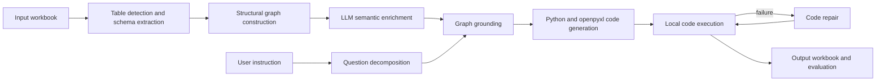

<div align="center">

# SheetCompass

### Hierarchical Relational Graphs for Agentic Spreadsheet Reasoning

Graph-grounded spreadsheet understanding, code generation, and verification for complex multi-table workbooks.

[](https://doi.org/10.1145/3862322.3863471)
[](https://doi.org/10.1145/3862322.3863471)
[](https://www.python.org/)

[English](./README.md) | [简体中文](./README_CN.md)

</div>

## Overview

Spreadsheet automation is difficult because workbook semantics are encoded not only in cell values, but also in table boundaries, column layouts, and dependencies across sheets. Converting a workbook into flat markdown preserves its text while discarding much of this structure. The resulting representation makes it especially hard for an LLM to identify join keys, trace cross-table dependencies, and safely execute long-horizon operations.

**SheetCompass** addresses this problem by turning a workbook into a structured evidence space. It represents tables and columns as a **Hierarchical Relational Graph (HRG)**, retrieves the task-relevant subgraph, grounds the user instruction to verified spreadsheet entities, and generates executable spreadsheet operations. The full framework described in our WSDM 2027 paper further combines this graph with multi-level memory and an Explorer-Programmer-Reflector workflow for iterative verification.

## Why SheetCompass?

- **Structure-aware reasoning.** Table and column nodes preserve workbook organization that is lost during flattening.
- **Cross-table grounding.** Semantic edges expose relationships such as shared product identifiers or dependent price and sales columns, even across worksheets.
- **Compact task context.** The agent retrieves relevant nodes and connector paths instead of sending the entire workbook to the LLM.
- **Executable outputs.** Grounded plans are translated into Python and `openpyxl` operations that produce modified `.xlsx` files.
- **Closed-loop reliability.** Execution failures can trigger code repair; the full paper framework additionally validates spreadsheet state through a dedicated reflector.
- **Traceable experiments.** Prompts, graph traces, generated code, execution logs, outputs, metrics, token usage, and estimated API cost are saved for inspection.

## Method

### 1. Hierarchical Relational Graph

SheetCompass detects table regions and constructs a graph with spreadsheet entities at multiple levels:

- **Table nodes** describe a detected table, its worksheet, range, dimensions, and schema.
- **Column nodes** store a column's name, position, inferred type, null rate, and representative values.
- **Structural edges** encode explicit organization, including sheet-table and table-column containment.
- **Semantic edges** connect logically related entities that may be physically distant, such as join keys on different sheets.

### 2. Multi-level Memory

The full SheetCompass framework maintains three complementary forms of memory:

- **Spreadsheet graph memory** stores the verified structural state of the workbook.
- **Expert knowledge memory** provides reusable spreadsheet-operation and tool-use knowledge.
- **Reasoning experience memory** retains lessons from successful and failed execution trajectories to reduce repeated mistakes.

### 3. Multi-agent Workflow

- The **Explorer** decomposes the instruction, identifies task-relevant graph nodes, and retrieves a compact connected subgraph.
- The **Programmer** turns the grounded subproblems into executable spreadsheet operations.
- The **Reflector** checks the resulting workbook against a task-specific checklist and returns diagnostic feedback when correction is needed.

The runnable pipeline on the current `main` branch follows this flow:



## Main Results

SheetCompass was evaluated on SheetCopilot Benchmark (SCB), SpreadsheetBench (SB), and SheetRM. Results below are percentages averaged over three independent runs; higher is better.

| Backbone | SCB Exec@1 | SCB Pass@1 | SB Soft | SB Hard | SheetRM Exec@1 | SheetRM Pass@1 |
|---|---:|---:|---:|---:|---:|---:|
| Qwen3.5-Plus | 95.1 | 63.2 | 22.6 | 18.3 | 93.7 | 42.5 |
| GPT-5 | **96.4** | **71.3** | **24.7** | **22.0** | **94.2** | **52.3** |

The ablation study shows that removing the HRG causes the largest overall degradation. With GPT-5, SCB Pass@1 drops from 71.3 to 56.4, SB Hard from 22.0 to 14.5, and SheetRM Pass@1 from 52.3 to 41.4. See the [paper](https://doi.org/10.1145/3862322.3863471) for complete baselines, ablations, efficiency analysis, and case studies.

## Repository Status

The current public runner includes:

- table-region detection and schema extraction;
- structural graph construction and LLM-based semantic enrichment;
- instruction decomposition and graph grounding;
- Python/`openpyxl` code generation, execution, and one repair pass;
- evaluation adapters for SpreadsheetBench and SheetCopilot;
- per-sample traces, output workbooks, aggregate metrics, and API-usage statistics.

The paper also reports the complete persistent-memory lifecycle, the full Explorer-Programmer-Reflector orchestration, and SheetRM experiments. These components are not all exposed through the current `main.py` command-line interface. Please keep this distinction in mind when reproducing the paper tables.

## Repository Layout

```text
sheetcompass/
├── main.py                 # Benchmark runner and end-to-end orchestration
├── data.py                 # SpreadsheetBench and SheetCopilot data loaders
├── evaluator.py            # Benchmark-specific evaluation and aggregate metrics
├── llm.py                  # OpenAI-compatible LLM client and usage accounting
├── run_code.py             # Generated-code execution and error summarization
├── model/
│   ├── tables.py           # Table detection and schema extraction
│   ├── graph.py            # Structural graph and semantic enrichment
│   ├── questions.py        # Decomposition and graph grounding
│   ├── codegen.py          # Code generation and repair
│   └── pipeline.py         # Graph-to-code pipeline
├── prompt/                 # Prompts and benchmark-specific few-shot examples
├── run_bench.sh            # SpreadsheetBench launch script
└── run_sc.sh               # SheetCopilot launch script
```

## Installation

### 1. Clone the repository

```bash
git clone https://github.com/PanJingHe/sheetcompass.git
cd sheetcompass
```

### 2. Create an environment

Python 3.10 or later is recommended.

```bash
python -m venv .venv
source .venv/bin/activate       # Windows: .venv\Scripts\activate
python -m pip install --upgrade pip
pip install openai openpyxl pyyaml python-dotenv tqdm
```

### 3. Configure an LLM endpoint

Create a `.env` file in the repository root:

```dotenv
API_KEY=your_api_key
# Optional: set this only when using an OpenAI-compatible custom endpoint.
# BASE_URL=https://your-endpoint.example.com/v1
```

You can also pass `--api_key` and `--base_url` directly. The client uses the OpenAI-compatible Chat Completions interface, so the model name must be supported by the selected endpoint.

> **Security:** never commit `.env`, API keys, private workbooks, or generated outputs containing sensitive data.

## Prepare the Benchmarks

SheetCompass does not redistribute benchmark data. Download each dataset from its official repository and follow its license and preparation instructions:

- [SpreadsheetBench](https://github.com/RUCKBReasoning/SpreadsheetBench)
- [SheetCopilot](https://github.com/BraveGroup/SheetCopilot)

The loaders expect the following key files:

```text
SpreadsheetBench/data/
└── sample_data_200/
    ├── dataset.json
    └── spreadsheet/...

SheetCopilot/dataset/
├── dataset.xlsx
├── task_sheets/
└── task_sheet_answers_v2/
```

If your downloaded release uses a different folder name, pass the matching path or version through the command-line arguments.

## Quick Start

Start with one sample to verify the environment and dataset layout.

### SpreadsheetBench

```bash
python main.py \
  --benchmark spreadsheetbench \
  --data_root /path/to/SpreadsheetBench/data \
  --dataset_name sample_data_200 \
  --num_samples 1 \
  --model gpt-4o-mini \
  --output_dir outputs
```

### SheetCopilot

```bash
python main.py \
  --benchmark sheetcopilot \
  --data_root /path/to/SheetCopilot/dataset \
  --sheetcopilot_gt_version task_sheet_answers_v2 \
  --num_samples 1 \
  --model gpt-4o-mini \
  --output_dir outputs
```

The examples use `gpt-4o-mini` for a low-cost smoke test. 
## Running Experiments

The provided shell scripts contain author-side default paths. Override them with your local dataset paths:

```bash
# SpreadsheetBench
bash run_bench.sh \
  --data_root /path/to/SpreadsheetBench/data \
  --num_samples 50

# SheetCopilot
bash run_sc.sh \
  --data_root /path/to/SheetCopilot/dataset \
  --num_samples 50
```

Useful options:

| Option | Description |
|---|---|
| `--benchmark` | `spreadsheetbench` or `sheetcopilot` |
| `--data_root` | Benchmark data root |
| `--dataset_name` | SpreadsheetBench subset, default: `sample_data_200` |
| `--sheetcopilot_gt_version` | SheetCopilot ground-truth folder |
| `--sample_id` | Run one specific sample |
| `--num_samples` | Maximum number of samples; `-1` means all |
| `--preview_rows` | Preview rows retained per detected table |
| `--model` | Model identifier sent to the configured endpoint |
| `--temperature` | Sampling temperature |
| `--max_tokens` | Maximum output tokens per LLM call |
| `--output_dir` | Root directory for outputs and logs |
| `--force-rerun` | Regenerate outputs even when they already exist |
| `--eval-only` | Evaluate existing output workbooks without calling an LLM |

To evaluate previously generated files, repeat the original dataset, model, and output arguments and add `--eval-only`:

```bash
python main.py \
  --benchmark spreadsheetbench \
  --data_root /path/to/SpreadsheetBench/data \
  --dataset_name sample_data_200 \
  --model gpt-4o-mini \
  --output_dir outputs \
  --eval-only
```

## Outputs

Each run writes artifacts under `outputs/<model>/<benchmark>/`:

```text
outputs/<model>/<benchmark>/
├── conv_single.jsonl           # Per-sample run summary
├── metrics.json                # Aggregate metrics and LLM usage
├── code/
│   └── <sample_id>.py          # Generated program
└── spreadsheets/
    └── <sample_id>/
        ├── *_output.xlsx       # Generated workbook(s)
        └── sample_io_log.json  # Graph, prompts, grounding, execution, repair
```

Generated code is executed locally and can modify workbook copies. Run the project on trusted data in an isolated environment, review generated programs, and keep backups of source workbooks.

## Reproducibility Notes

- Paper results use GPT-5 with medium reasoning effort and Qwen3.5-Plus with temperature 0.0; the examples above are smoke-test configurations.
- The paper uses a maximum generation length of 4,096 tokens and averages reported results over three runs.
- Benchmark metrics are not interchangeable: SCB and SheetRM report Exec@1/Pass@1, while SpreadsheetBench reports Soft/Hard restriction scores.
- LLM APIs, model snapshots, dataset versions, and spreadsheet-engine behavior can affect exact numbers. Record the model version, endpoint, dataset revision, arguments, and commit hash for each run.

## Citation

If you find SheetCompass useful, please cite:

```bibtex
@inproceedings{he2027sheetcompass,
  title     = {SheetCompass: Hierarchical Relational Graphs for Agentic Spreadsheet Reasoning},
  author    = {He, Panjing and Cheng, Mingyue and Luo, Yucong and Li, Li and Zhang, Xiaohan},
  booktitle = {Proceedings of the Twentieth ACM International Conference on Web Search and Data Mining},
  year      = {2027},
  publisher = {ACM},
  doi       = {10.1145/3862322.3863471},
  url       = {https://doi.org/10.1145/3862322.3863471}
}
```

## Acknowledgments

This research was supported by the National Natural Science Foundation of China (Grant No. 62502486), the Fundamental Research Funds for the Central Universities, and the Dream Set Off Kunpeng & Ascend Seed Program.

## License and Contact

This repository currently does not include a software license. Unless a license is added, default copyright rules apply. Third-party benchmarks remain subject to their original licenses.

For questions about the paper or code, please open a GitHub issue or contact **Panjing He** at `hepanjing@mail.ustc.edu.cn`.
